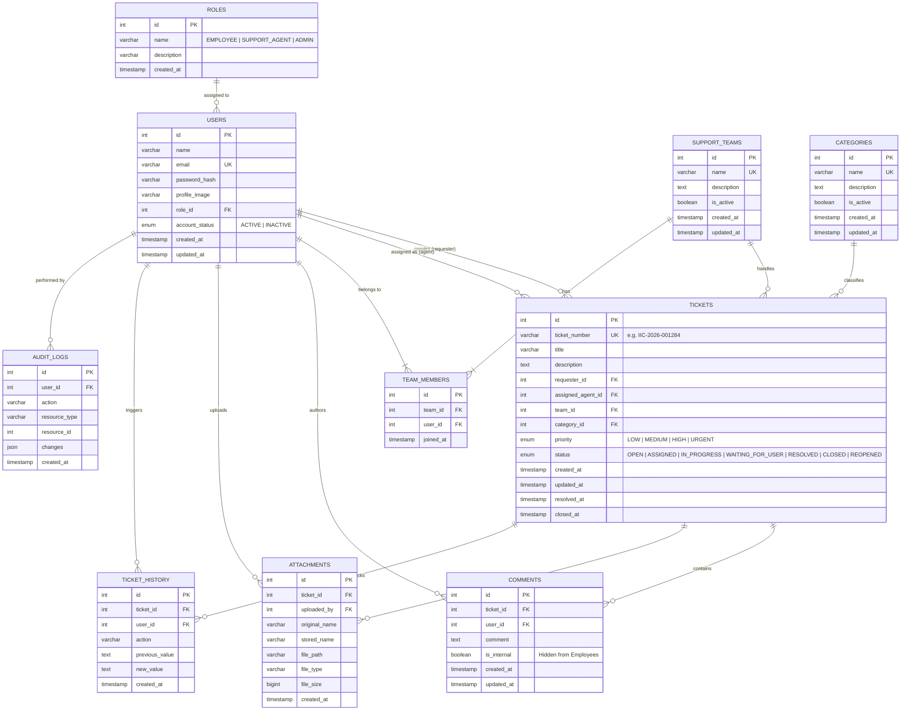

# IT Service Desk & Support Management System
## Entity-Relationship (ER) Diagram & Database Design

This document details the database architecture and entity relationships required by the **IT Service Desk & Support Management System** specification (Sections 27 & 34).

---

### Mermaid ER Diagram

---

### Entity Descriptions & Relationships

1. **`roles`**:
   - `id = 1`: `EMPLOYEE` — can create tickets, view own tickets, add public comments, upload attachments, reopen resolved tickets.
   - `id = 2`: `SUPPORT_AGENT` — can view assigned tickets and team tickets, change status/priority, add internal comments.
   - `id = 3`: `ADMIN` — can manage users, support teams, categories, reassign tickets, and view audit logs.

2. **`users`**:
   - Authenticated via Google OAuth 2.0 or Email/Password with JWT.
   - Tied to a single role (`roles.id`).
   - Account status can be toggled (`ACTIVE` or `INACTIVE`).

3. **`support_teams` & `team_members`**:
   - Support teams group agents (e.g., Tier 1 Helpdesk, Infrastructure, Applications).
   - Many-to-many relationship with `users` through `team_members` (`team_id`, `user_id`).

4. **`categories`**:
   - Ticket classification (`Hardware`, `Software`, `Network`, `Account Access`, `Email`, `Security`, `Other`).
   - Can be enabled, disabled, created, and updated by Admins.

5. **`tickets`**:
   - Primary operational entity. Each ticket has a unique human-readable ticket number (e.g., `IIC-2026-001284`).
   - Tracks status transitions through the lifecycle: `OPEN` -> `ASSIGNED` -> `IN_PROGRESS` -> `WAITING_FOR_USER` -> `RESOLVED` -> `CLOSED` (or `REOPENED`).
   - Captures `resolved_at` and `closed_at` timestamps for SLA/metrics.

6. **`comments`**:
   - Collaboration trail.
   - `is_internal` boolean: when `1`, the comment is strictly isolated to Support Agents and Admins, completely hidden from the ticket requester.

7. **`attachments`**:
   - Stores metadata for uploaded files (screenshots, logs, PDFs).
   - File validation ensures allowed MIME types and size constraints before saving to `uploads/`.

8. **`ticket_history`**:
   - Immutable historical timeline of all status changes, assignments, and priority changes on each ticket.

9. **`audit_logs`**:
   - System audit trail for administrative actions (role changes, account deactivations, team changes, category edits).
